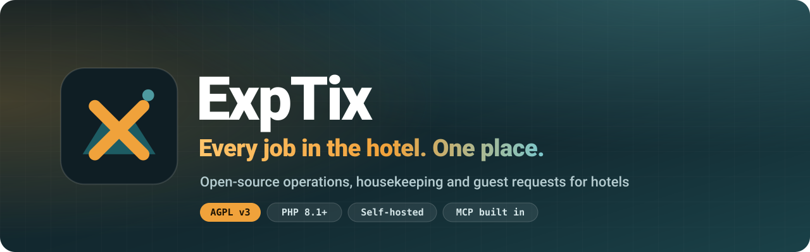
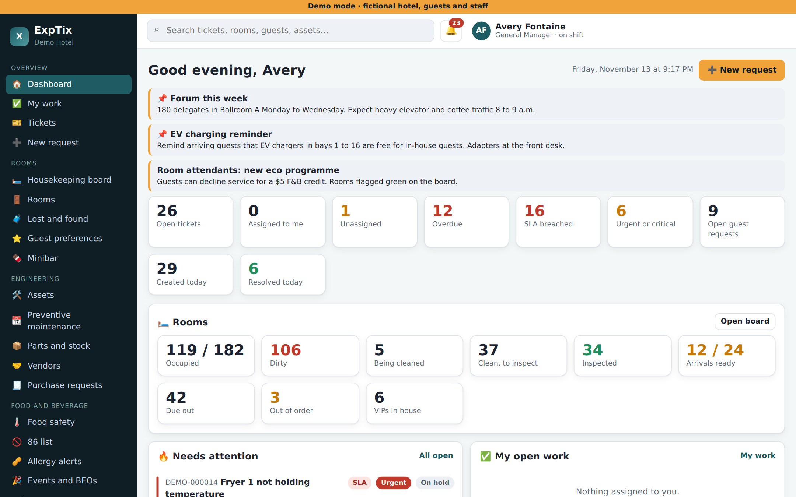
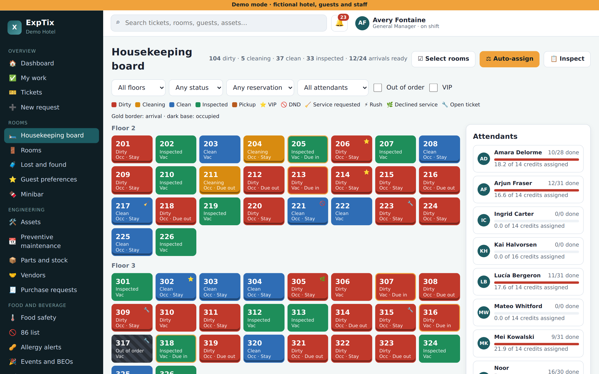
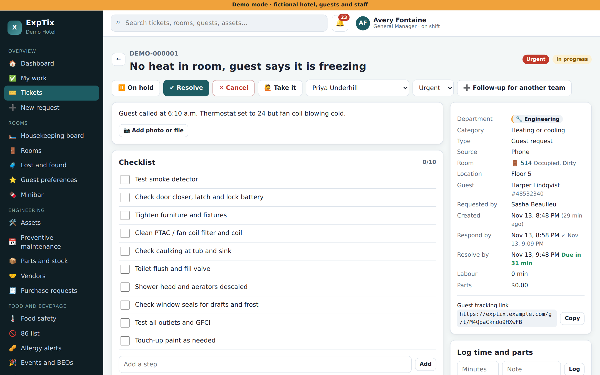
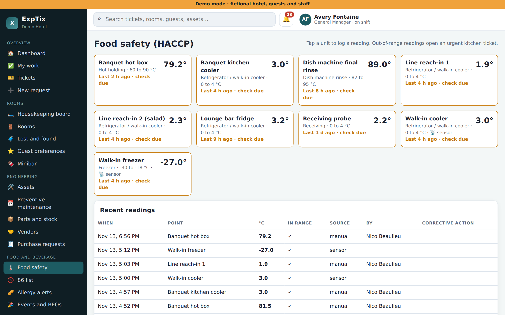
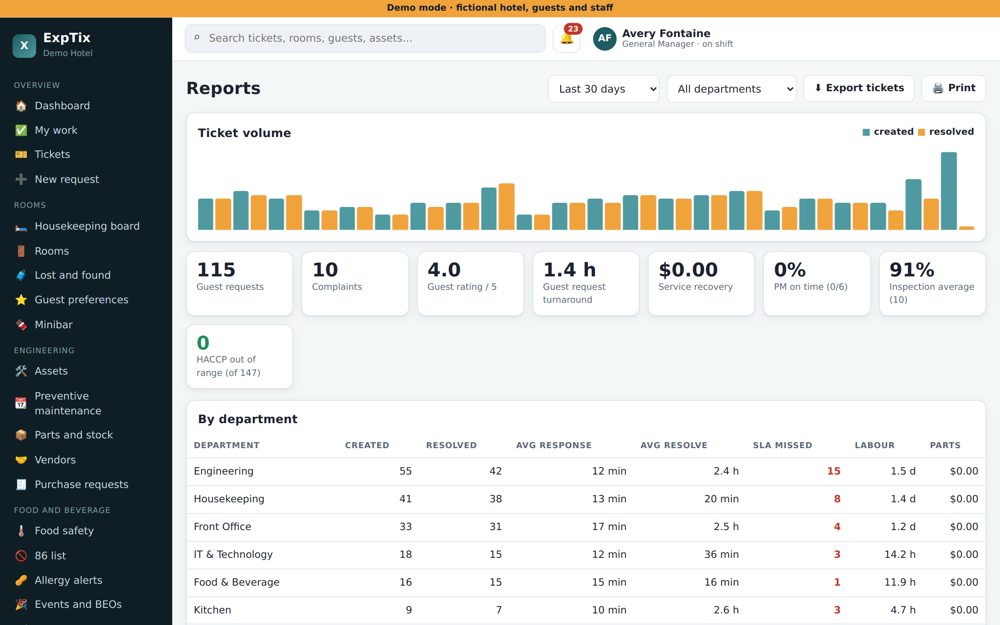
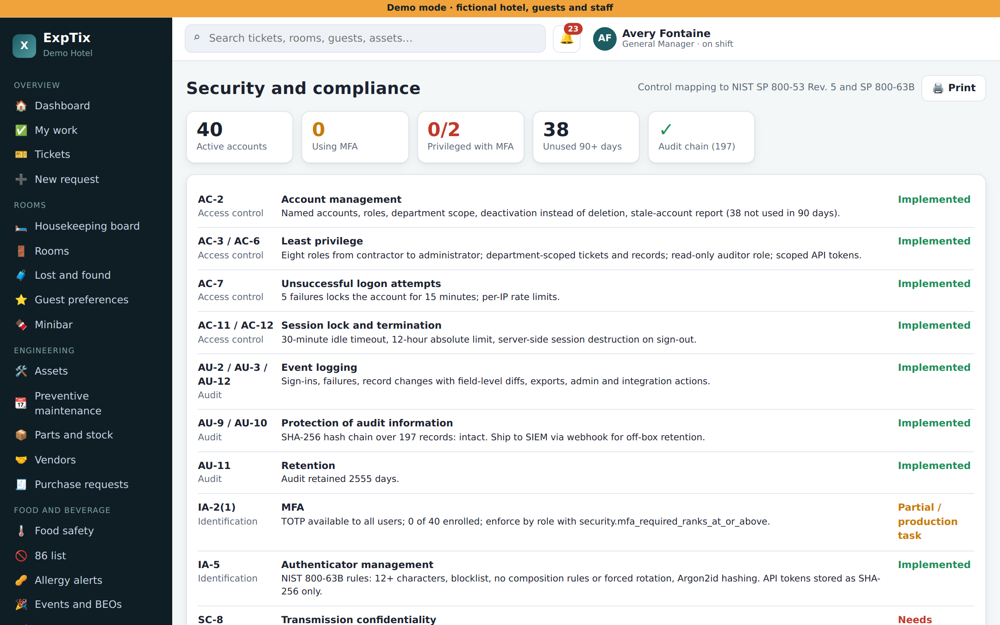
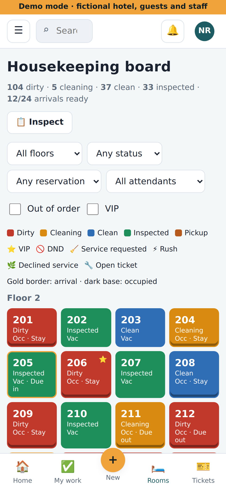
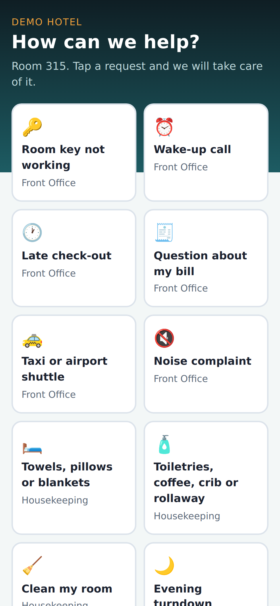

<p align="center">
  <a href="https://moosesystems.github.io/EXPTIX/"></a>
</p>

<p align="center">
  <a href="LICENSE"></a>
  
  
  
  
</p>

<p align="center">
  <b><a href="https://moosesystems.github.io/EXPTIX/">Website</a></b> ·
  <b><a href="#-run-it-in-5-minutes">Quick start</a></b> ·
  <b><a href="https://moosesystems.github.io/EXPTIX/guide/">How-to guides</a></b> ·
  <b><a href="docs/DEPLOYMENT.md">Deployment guide</a></b> ·
  <b><a href="#-features">Features</a></b> ·
  <b><a href="CONTRIBUTING.md">Contribute</a></b>
</p>

---

**ExpTix (Expert Tickets)** is free, self-hosted operations software for hotels. Guest requests, repairs, housekeeping, food safety, events and incidents flow to the right team, on a timer, with a full record of who did what. It runs in any browser, installs on a phone like an app, and needs nothing more than ordinary PHP hosting.

> A hotel runs on hundreds of small jobs a day. Without one shared place they live in radio calls, sticky notes and people's heads. ExpTix gives every department one list: it routes the job, starts the clock, nudges people, escalates when it slips, and remembers everything.

<p align="center">
  
</p>

## ✨ Features

| | |
|---|---|
| 🎫 **Tickets with teeth** | Auto-routing from plain language. SLAs with warning, breach and escalation. Checklists, labour, parts, photos, follow-ups for other teams, repeat-issue detection and service recovery. |
| 🛏️ **Live housekeeping board** | Every room at a glance. Credit-based auto-assignment, DND, rush, declined service, out of order, inspections and minibar posting. |
| 🔧 **Engineering and PM** | Assets, preventive maintenance that opens its own tickets, parts and stock, vendors with insurance expiry, purchase requests with approval. |
| 🌡️ **Food safety (HACCP)** | Temperature logging by hand or sensor. Out-of-range readings open an urgent kitchen ticket. 86 list, allergy alerts, events and BEOs. |
| 📱 **Guest QR portal** | A code in every room. Guests ask, track and rate with no app and no sign-in. Low ratings alert the front office. |
| 🛡️ **Security and incidents** | Incident reports, key control, lost and found, and a hash-chained audit log. |
| 🔔 **Notifications that land** | In-app, web push, email, SMS (Twilio), Microsoft Teams, Slack and signed webhooks, routed by rules. |
| 🔌 **Integrations** | Oracle Opera Cloud (OHIP), Canary, email to ticket, IoT sensors, Zapier, Make and Power Automate. Every one has a mock mode. |
| 🤖 **AI-ready** | REST API with OpenAPI 3.1 and a built-in **MCP server** with 19 tools, so AI assistants can brief a shift, triage requests and update work under a staff user's permissions. |
| 🔐 **Secure by default** | Argon2id, lockout, TOTP MFA, session limits, hashed scoped API tokens, encrypted secrets, strict headers. Controls mapped to NIST SP 800-53 Rev. 5 and SP 800-63B on a live compliance page. |

## 📸 Tour

<p align="center">
  
  
</p>
<p align="center"><sub><b>Housekeeping board:</b> every room colour coded, with auto-assign and workload &nbsp;·&nbsp; <b>Ticket:</b> checklist, SLA clock, guest tracking link, labour and parts</sub></p>

<p align="center">
  
  
</p>
<p align="center"><sub><b>Food safety:</b> HACCP points with safe ranges and overdue checks &nbsp;·&nbsp; <b>Reports:</b> volume, response, SLA misses, ratings, labour and parts</sub></p>

<p align="center">
  
  
  
</p>
<p align="center"><sub><b>Security and compliance:</b> live NIST control map &nbsp;·&nbsp; <b>Mobile:</b> the staff app and the guest QR portal</sub></p>

      <sub><b>Mobile:</b> staff app and the guest QR portal</sub>
    </td>
  </tr>
</table>

<sub>All screens show the built-in demo hotel. Every name in them is fictional.</sub>

## 🚀 Run it in 5 minutes

Needs PHP 8.1+ with `pdo_sqlite`, `sodium`, `openssl`, `mbstring` and `curl`. No framework, no Composer, no build step.

```bash
git clone https://github.com/moosesystems/EXPTIX.git exptix
cd exptix
php app/bin/cli.php migrate
php app/bin/cli.php seed          # fictional 182-room demo hotel; prints the passwords
php -S localhost:8080 -t public public/index.php
```

Open <http://localhost:8080> and sign in as **`gm`** with the `demo_password` that `seed` printed. Try `hk1` on your phone's browser for the room attendant view.

### Going to production

| | Where | Time |
|---|---|---|
| 💻 | **Local trial:** PHP's built-in server and SQLite | 5 minutes |
| 🐧 | **Your own server:** nginx or Apache, PHP-FPM, MySQL, Let's Encrypt, cron ([example configs](deploy/)) | About an hour |
| ☁️ | **Shared hosting:** any plan with PHP 8.1, MySQL and cron | About an hour |

Start production installs with `php app/bin/cli.php create-admin` instead of the demo data. Everything is in the **deployment guide**: [Markdown](docs/DEPLOYMENT.md) · [HTML](https://moosesystems.github.io/EXPTIX/DEPLOYMENT.html) · [Word](docs/DEPLOYMENT.docx).

## 👥 Built for every role

🌟 **General manager:** the whole property · 🛎️ **Front desk:** log anything a guest asks · 🧹 **Housekeeping:** my rooms, my order · 🔧 **Engineering:** work orders, PM, parts · 👨‍🍳 **Kitchen and F&B:** temperatures, allergies, BEOs · 🛡️ **Security:** incidents, keys, lost and found · 🧰 **Contractors:** only their jobs · 🔍 **Auditors:** read-only records and audit trail

## 📚 Documentation

- **[How-to-use guides](https://moosesystems.github.io/EXPTIX/guide/)** ([source](docs/guide/src)): printable one-page sheets for every role from room attendant to CFO and VP of operations, playbooks from a three-room lodge to a 3,000-room group, a 90-day rollout plan, FAQs and a glossary. Frontline sheets also in French, Spanish and Tagalog. Each one as a web page, PDF and Word file.
- **[Deployment guide](docs/DEPLOYMENT.md):** requirements, local trial, Linux servers, shared hosting, sub-folders, every setting, cron, notifications, integrations and webhooks, API tokens and MCP, the security checklist, backups, upgrades and troubleshooting.
- **Staff how-to guide:** `/HowTo.html` on every install. Each screen explained by role, with a 10-minute GM tour.
- **API reference:** `/docs` and `/api/openapi.json` on every install.

## 🗂️ Project layout

```
app/       PHP application, CLI and config (never web reachable)
public/    Web root: front controller, assets, how-to guide
deploy/    Example nginx, Apache and cron files
scripts/   Helper scripts
docs/      Website, deployment guide, screenshots
```

## 🧭 Status and roadmap

ExpTix is at **v0.9**: feature complete for a single property and ready for pilots. Before real guest data goes in, work through the security checklist in the deployment guide.

On the roadmap: multi-property installs, single sign-on (Entra ID, Google), translations, live door lock and BMS connectors, and a Docker image. Ideas and pull requests are welcome.

## 🤝 Contributing and security

Read [CONTRIBUTING.md](CONTRIBUTING.md) to get started. Please report vulnerabilities privately through the **Security** tab as described in [SECURITY.md](SECURITY.md), never in a public issue.

## ⚖️ Licence

Copyright (C) 2026 The ExpTix contributors.

ExpTix is free software: you can redistribute it and/or modify it under the terms of the GNU Affero General Public License as published by the Free Software Foundation, either version 3 of the License, or (at your option) any later version. It is distributed in the hope that it will be useful, but WITHOUT ANY WARRANTY; without even the implied warranty of MERCHANTABILITY or FITNESS FOR A PARTICULAR PURPOSE. See [LICENSE](LICENSE).

If you run a modified version for users over a network, the AGPL requires you to offer them its source. Set `source_url` in your config to your repository.

<sub>Oracle, Opera, Canary, dormakaba, Twilio, Microsoft Teams, Slack and other names are trademarks of their owners. ExpTix is not affiliated with or endorsed by them.</sub>
